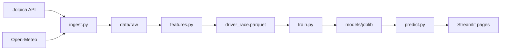

# Architecture

Pitstop Oracle is a small ML pipeline plus a Streamlit dashboard. Data flows in one direction: free APIs → Parquet files → feature table → trained models → predictions in the UI.

## Pipeline overview

## Module map

| Module | Role |
|---|---|
| [`ml/f1ml/adapters/`](../ml/f1ml/adapters/) | Pluggable sources: Jolpica, OpenF1, Open-Meteo, manual CSV |
| [`ml/f1ml/schema/`](../ml/f1ml/schema/) | Canonical entity definitions |
| [`docs/DATASET.md`](DATASET.md) | Stable schema, relations, null rules |
| [`ml/f1ml/calendar.py`](../ml/f1ml/calendar.py) | Race calendar helpers; next upcoming GP without model imports |
| [`ml/f1ml/ingest.py`](../ml/f1ml/ingest.py) | Pull races, results, qualifying, standings, weather from Jolpica + Open-Meteo; sync canonical |
| [`ml/f1ml/starting_grid.py`](../ml/f1ml/starting_grid.py) | Official starting grid merge (OpenF1 + manual) |
| [`ml/f1ml/features.py`](../ml/f1ml/features.py) | One row per driver per race; rolling form, circuit overtaking index, teammate H2H |
| [`ml/f1ml/specs.py`](../ml/f1ml/specs.py) | Pre-quali vs post-quali feature definitions |
| [`ml/f1ml/ratings.py`](../ml/f1ml/ratings.py) | Era-reset constructor pace + driver skill EWMA ratings |
| [`ml/f1ml/ranking.py`](../ml/f1ml/ranking.py) | Pairwise ranker, Plackett-Luce markets, DNF hazard |
| [`ml/f1ml/train.py`](../ml/f1ml/train.py) | Dual-mode training, 2026 walk-forward eval, recency weights |
| [`ml/f1ml/predict.py`](../ml/f1ml/predict.py) | Weekend card API: win, podium, DNF, finish, fantasy points |
| [`ml/f1ml/fantasy.py`](../ml/f1ml/fantasy.py) | F1 Fantasy-style expected points engine |
| [`ml/f1ml/eval.py`](../ml/f1ml/eval.py) | Log-loss, Brier, calibration, rank correlation |
| [`ml/f1ml/ui/`](../ml/f1ml/ui/) | Theme, Plotly charts, shared Streamlit components |
| [`ml/pages/`](../ml/pages/) | This Weekend, Race Explorer, Fantasy Lab, Model Performance |

## Training split

- **Train:** 2022–2026 seasons (includes completed 2026 races)
- **Eval:** walk-forward by season (no fixed held-out test split)
- **Modes:** separate `pre_quali` and `post_quali` model bundles in `ml/models/`

The first baseline is always **pole sitter** (post-quali only). Pre-quali is compared to equal field and championship leader.

## Upcoming race predictions

For races not yet in `driver_race.parquet` (no race results row yet):

1. `resolve_race_features(season, round)` uses completed rows from `driver_race.parquet` only when the race has a winner
2. Otherwise it always builds via `build_upcoming_race_features()` using the latest completed round in the season for driver lineup and form
3. Championship standings come from standings after that round
4. Qualifying columns are merged live from `data/raw/qualifying.parquet` when available
5. **FP pace** (FP1–FP3) comes from `data/canonical/fp_pace.parquet` (OpenF1); `fp_best_delta` prefers FP3 → FP2 → FP1
6. **Starting grid** is merged from `data/canonical/starting_grid.parquet` (OpenF1 + `data/manual/starting_grid.csv`) — penalties applied via `grid` and `grid_vs_quali`, not quali copy

## Weekend ingest (default pipeline)

`python run_pipeline.py` (no flags):

- Bypasses Jolpica disk cache for the **current calendar year** so new qualifying/results appear without `--all-data`
- Does **not** cache Jolpica 404 responses (future pit-stop/standings endpoints retry on later runs)
- Syncs OpenF1 for the **next upcoming GP**: FP1–FP3 pace, official starting grid, weather forecast
- Force-refreshes FP data for that round even when historical FP backfill is skipped
- Clears in-process prediction caches after feature rebuild (Streamlit picks up new parquet on the next interaction)

Use `python run_pipeline.py --all-data` (alias `--refresh`) to clear cache and re-fetch **2022–present**.

## Future warehouse

[`dataCollectionService/`](../dataCollectionService/) is a TypeScript + Postgres schema for a future API. It is **not** required for v1 training or the dashboard.
