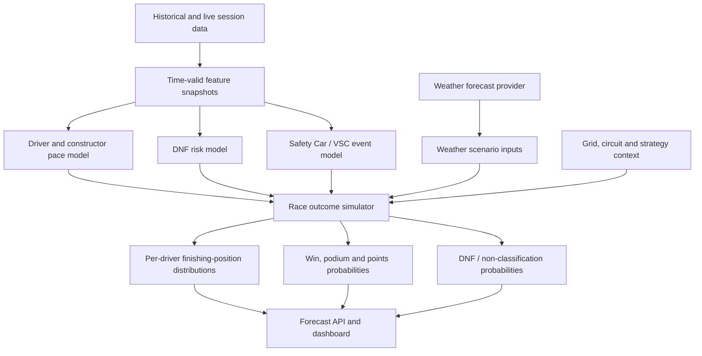

# Pitstop Oracle — Model Development Roadmap

> **Audience:** Codex and the project owner.
>
> **Purpose:** Define the complete model-development path for Pitstop Oracle: what each model should predict, how model outputs combine, what data each model needs, how to validate them, and in what order to implement them.
>
> **Relationship to the companion plan:** Read `docs/PHASE_1_FORECAST_PLAN.md` first. That document owns forecast cutoffs, leakage prevention, feature auditing, data quality and model lifecycle. This document owns the modeling strategy and staged model implementation.
>
> **Execution rule:** Do not implement every model at once. Complete the phases in order, produce evidence at each gate, and stop for owner review at the checkpoints.

---

## 1. Product goal and prediction contract

For every Grand Prix, Pitstop Oracle should produce predictions at two defined stages:

1. **Pre-qualifying:** after the final relevant practice session and before qualifying begins.
2. **Post-qualifying:** after qualifying is complete and the official race starting grid, including penalties, is finalized.

Sprint weekends require explicit variants. Do not treat "post-qualifying" as a sufficient cutoff label if sprint results may or may not be available. The product must say whether a forecast is before or after the sprint.

### Required output

For every driver in the event, the product should eventually return:

- A probability distribution over finishing positions: P1 through Pn.
- Expected finishing position.
- Win probability.
- Podium probability.
- Points-finish probability.
- DNF / non-classification probability, shown separately.
- A short explanation of the strongest factors affecting the forecast, where supported by the model and data.

The position probabilities should be coherent: for a classified finishing-order distribution, each simulated race has one driver in each position and each driver's probabilities across positions sum to approximately 1. DNF treatment must be represented explicitly and documented so that a DNF probability is not confused with an ordinary finishing position.

### Product principle

The product is not merely a winner classifier. It is a race-outcome forecasting system. The core object is a distribution over possible race outcomes for the full field.

---

## 2. Current model architecture — baseline to preserve

The current implementation already has a useful foundation:

- `HistGradientBoostingRegressor` in `ml/f1ml/ranking.py` estimates a latent performance score trained against negative finishing position. The class/function naming says "ranker", but this is currently a regression model, not a classical pairwise ranking objective.
- `HistGradientBoostingClassifier` estimates DNF probability.
- `WeekendRanker` combines the score and DNF estimates.
- A Plackett–Luce sampling implementation simulates complete finishing orders and estimates win, podium, points and expected-finish outputs.
- `ml/f1ml/specs.py` defines separate pre-quali and post-quali feature sets.
- `ml/f1ml/train.py` performs walk-forward evaluation and temperature calibration.

Do not replace this baseline until the data contract, training labels and evaluation are trustworthy.

### Current baseline limitations to investigate

- The ranking regressor learns a score from final position, which is a useful first baseline but does not directly learn a complete probabilistic finishing-position distribution.
- Current DNF adjustment uses a fixed score penalty. It is a heuristic, not a learned physical or probabilistic relationship.
- Current Plackett–Luce simulation forces every driver into a complete order. It does not explicitly simulate retirements/non-classification as a distinct outcome.
- The fast walk-forward evaluation path and full inference path do not calculate all outputs in exactly the same way. Align primary evaluation with production inference.
- Existing metric files contain both training diagnostics and out-of-sample results. Never use in-sample metrics as evidence of predictive performance.

---

## 3. Target model architecture

Build the system as a collection of focused estimators feeding a race-outcome simulator. The architecture should grow only when each added component demonstrates value.

This is the target architecture, not a requirement to create all components immediately.

### Model responsibilities

| Component | Main question it answers | Initial approach |
|---|---|---|
| Pace / performance | How competitive is each driver-car combination at this event? | Existing HistGradientBoosting regression baseline |
| DNF risk | How likely is each driver-car combination to fail to finish? | Existing HistGradientBoosting classifier, after fixing its training population |
| Weather | What weather conditions are plausible at the event? | External forecast input; do not train a weather forecasting model |
| Safety Car / VSC | What is the probability and likely impact of neutralization? | Separate probability model, only after reliable event/session labels exist |
| Strategy / pit-stop | How might tyre and pit strategy affect race pace and outcome? | Later; start with descriptive features and scenario analysis |
| Race outcome simulator | Given pace, grid, risk and scenarios, what finishing orders are plausible? | Existing Plackett–Luce foundation, extended and validated incrementally |

Do not make all model outputs independent by assumption. Weather, safety cars, tyre strategy, incidents and DNF risk can be correlated. The simulator should eventually represent shared race scenarios rather than multiplying independent probabilities blindly.

---

## 4. Model 1 — Driver/car pace and relative performance

### Objective

Estimate relative competitive pace for every driver in the field at a specific circuit and forecast stage.

This should be the central model. It should learn the combined effect of driver ability, constructor/car performance, current form, circuit fit and available weekend evidence.

### Inputs to consider

Only include features proven to be available by the forecast cutoff. The companion forecast-integrity plan defines the rules.

**Driver form**
- Recent finishing-position and points trends, shifted to prior events.
- Driver performance relative to teammate.
- Historical circuit performance, with strong safeguards for small sample sizes.
- Driver skill rating carried across regulation eras cautiously.

**Constructor/car form**
- Current-season relative constructor pace.
- Recent constructor performance.
- Constructor reliability history.
- Constructor pace rating reset or down-weighted at regulation changes.
- Teammate-relative performance to help distinguish driver contribution from car contribution.

**Circuit context**
- High-, medium- and low-speed corner proportions.
- Straight length and straight-line opportunity.
- Overtaking difficulty.
- Elevation / altitude.
- Pit-lane time loss.
- Surface and tyre-degradation proxies where reliable.

**Current weekend**
- Practice best-lap pace relative to the field.
- Long-run pace relative to the field.
- Session-specific pace deltas (FP1/FP2/FP3 only when available by cutoff).
- Qualifying position and gaps for post-quali only.
- Official starting grid and penalty movement for post-quali only.

### Car characteristics: measured vs inferred

Maintain a distinction in code and documentation:

- **Directly measured:** speed traps, lap/sector times, practice long runs, pit-stop times, reliability outcomes.
- **Inferred:** straight-line efficiency, high-speed/low-speed cornering strength, braking strength, tyre degradation, aero efficiency.

Do not fabricate a numeric car trait because a circuit or team is known for it. Estimate it from available measurements, state uncertainty, and compare it against simpler pace features.

Potential interaction features to test:
- `grid_position × overtaking_difficulty`
- `current_season_relative_pace × high_speed_corner_ratio`
- `straight_line_speed_index × straight_length_ratio`
- `low_speed_corner_index × low_speed_corner_ratio`

These are hypotheses, not mandatory columns. Add them one at a time and retain them only if walk-forward results improve.

### Important modeling decisions

- Prefer relative pace deltas to raw lap times across circuits.
- Normalize within the event/session where appropriate.
- Avoid per-circuit models at the beginning. Use numerical circuit attributes so one model can learn track similarity.
- Keep separate feature views for pre-quali and post-quali.
- Use current-season information more heavily only when validated; do not hand-code arbitrary weights.
- Keep a neutral/uncertain prior for a new constructor or driver when evidence is sparse.

### Candidate model comparisons

After the existing baseline is trustworthy, compare:
1. Existing HistGradientBoostingRegressor.
2. A simple regularized linear model as an interpretable baseline.
3. Random Forest / Extra Trees as alternative tree ensembles.
4. A proper learning-to-rank approach only if it offers a clear benefit and the evaluation supports it.

Do not optimize model complexity before validating the target and data.

---

## 5. Model 2 — DNF / non-classification risk

### Objective

Estimate the probability that each driver does not receive a normal classified finish.

First define the target precisely. F1 official status strings, classification rules, retirements and late-race classified finishers need careful treatment. The target should not casually combine all of these into one vague label.

### Initial target

Create and document a deterministic label from official race result/status data:

- `dnf = 1`: official non-classification / retirement according to the agreed definition.
- `dnf = 0`: official classified finisher under the agreed definition.

Keep the raw official `status` and classification fields so that the derived label can be audited. Consider separate labels later for mechanical failure, accident/incident, disqualification and other non-classification causes if source data quality supports it.

### Critical implementation requirement

The current training path appears to filter rows to non-null numeric finishing positions before passing data into the DNF classifier. Verify this carefully. If DNF examples are excluded, separate the ranking training population from the DNF training population.

The DNF model must receive both positive and negative examples. Add tests that assert this.

### Candidate features

- Historical driver DNF rate, shifted to prior races.
- Historical constructor DNF rate, shifted to prior races.
- Car/driver reliability ratings.
- Circuit incident and retirement history, era-aware.
- Weather forecast / wet conditions available at cutoff.
- Grid position and traffic exposure when available.
- Reliability trend across current regulation era.

Avoid treating a wet forecast as proof of a DNF. It is only one possible risk factor.

### Evaluation

Report:
- Precision and recall at chosen thresholds.
- PR-AUC (useful when DNF examples are relatively uncommon).
- ROC-AUC as a secondary metric.
- Log loss and Brier score.
- Calibration: among drivers assigned 20% DNF risk, do roughly 20% actually fail to finish over a sufficiently large sample?
- Results by era, constructor and weather condition where sample size permits.

Do not judge the DNF model only by accuracy; a model predicting "no DNF" for everyone can look deceptively accurate when DNF is uncommon.

---

## 6. Model 3 — Weather input and scenarios

### Objective

Represent plausible weather conditions at the event and pass those conditions into the pace and race-outcome models.

**Do not train a weather prediction model in this project.** Weather forecasting is already a specialized external capability. Use a weather provider and record the forecast as it existed at the prediction cutoff.

Initial variables:
- Precipitation probability / amount.
- Air and track temperature if available.
- Wind speed/direction if available and reliable.
- Forecast timestamp and forecast horizon.
- Weather uncertainty or multiple plausible scenarios where provider data supports it.

### Critical distinction

Historical observed weather is not interchangeable with the forecast that was available before a historical race. For valid backtesting, use archived forecast snapshots if available. If not, exclude actual event weather from pre-race training and report the limitation.

### Model interaction

Initially use weather as an input to the pace/risk model and as a scenario variable in the simulator. Later, if enough clean data exists, compare dry/wet pace effects separately.

Do not infer that a forecast of rain guarantees a wet race. Preserve uncertainty and forecast timing.

---

## 7. Model 4 — Safety Car and Virtual Safety Car probability

### Objective

Estimate the likelihood of a Safety Car (SC) or Virtual Safety Car (VSC) during a race, and eventually how such neutralizations change the outcome distribution.

### Candidate predictors

- Circuit-specific historical SC/VSC frequency.
- Circuit layout and overtaking/incident proxies.
- Weather forecast available at cutoff.
- Grid density / starting positions.
- Historical incident and retirement rates.
- Regulation era and relevant race format.

### Data requirements

Before training, identify a reliable source for SC/VSC event labels and timestamps. The current Jolpica result/status data alone may not provide enough detail to build high-quality event labels. Inspect FastF1/OpenF1 or another suitable source and document coverage and licensing/terms before committing to it.

Potential targets:
- Any SC during race (binary).
- Any VSC during race (binary).
- Number of SC/VSC periods (count) only if labels are reliable.
- First neutralization lap / timing only if event timestamps are reliable.

### Staged implementation

1. Build a circuit-level descriptive baseline.
2. Validate label coverage and event definitions.
3. Train binary SC and VSC classifiers only when enough examples exist.
4. Evaluate probability calibration and log loss chronologically.
5. Pass scenarios to the race simulator only after proving the model is useful.

Do not start with a detailed SC deployment-time predictor.

---

## 8. Model 5 — Strategy, tyre degradation and pit-stop effects

### Objective

Represent how strategy and tyre behavior can alter pace and final positions.

This is a later model family, not a Phase 1 prerequisite.

Potential data:
- Tyre compound and stint length.
- Lap-by-lap pace.
- Pit-stop lap and duration.
- Pit-lane loss.
- Safety Car / VSC timing.
- Weather and track temperature.
- Historical team strategy patterns.

Potential future outputs:
- Expected tyre degradation curve.
- Pit-stop count / window estimates.
- Strategy scenario comparisons.
- Expected time loss or gain from an undercut/overcut.

Do not infer degradation from a driver's overall race time without controlling for fuel load, traffic, compound, track evolution, weather and neutralizations. Start with descriptive analysis and simple regression before considering a complex strategy simulator.

---

## 9. Race outcome simulator — turn component outputs into a field distribution

### Objective

Combine driver pace, starting grid, DNF risk and race-level scenarios to produce a coherent distribution of finishing positions for every driver.

The current Plackett–Luce sampler is a useful first implementation. Preserve it as the baseline and validate its assumptions.

### Version 1 — current baseline

- Predict relative driver scores.
- Apply the existing DNF adjustment.
- Sample complete finishing orders using Plackett–Luce.
- Estimate each driver's P1...Pn probability, win, podium, points and expected finish.

First test whether the current output is calibrated and whether the DNF adjustment improves out-of-sample performance.

### Version 2 — explicit DNF outcome

Design an explicit non-classification outcome rather than forcing every driver to finish P1...Pn.

Questions to resolve:
- Is the target official non-classification, mechanical retirement, or any retirement?
- Does a DNF receive no finishing position in the UI, or should the product separately show classified-position conditional probabilities?
- How should a race with multiple DNFs affect the number of classified positions?
- How do late retirements and classified drivers who completed fewer laps appear in official results?

A possible modeling structure is:
1. Sample whether each driver is classified using calibrated DNF probabilities, with dependencies/scenarios considered.
2. Generate a finishing order among classified drivers.
3. Apply official classification conventions only if the product intends to display official classified positions.
4. Preserve DNF probability separately from conditional position probabilities.

Do not implement this mechanically without defining the probability semantics and validating that the resulting field distribution is coherent.

### Version 3 — shared race scenarios

Introduce scenario-level simulation for common factors:

- Weather scenario (dry / changing / wet, only where supported).
- SC/VSC occurrence and timing scenarios.
- Strategy / pit-stop scenario.
- Pace variation and driver execution uncertainty.
- DNF and incident dependencies.

Each simulation draw should represent a plausible shared race environment. This is important because weather and SC affect multiple drivers at once; independent per-driver adjustments can produce unrealistic outcomes.

### Output validation

For each race:
- Probabilities are bounded between 0 and 1.
- Per-driver position probabilities have valid sums under the chosen semantics.
- Race-level win probabilities sum to approximately 1 across eligible drivers.
- Podium and points probabilities are consistent with the simulated field size/rules.
- DNF probability is not accidentally double-counted.
- Results are deterministic for a fixed model version, inputs and random seed.
- The full distribution is saved, not only the expected finish.

---

## 10. Regulation changes, concept drift and historical data

2026 represents a new technical regulation era. Treat it as a distribution shift: the relationship between historical car performance and race outcomes can change.

Feature transferability differs:

- Circuit geometry and altitude: generally transferable.
- Driver skill: partially transferable, but still affected by car and context.
- Historical SC/VSC frequency: potentially transferable, but review era and circuit changes.
- Constructor/car pace: low transferability across major regulation resets.
- Strategy/tyre behavior: can change substantially with regulations and tyre rules.

Required approach:
- Preserve an explicit `regulation_era` feature.
- Reset or cautiously reinitialize constructor pace ratings at the 2026 boundary.
- Do not automatically reset all driver information.
- Avoid arbitrary hand-coded percentages for old vs new seasons.
- Run pre-2026-to-2026 transfer tests and live-like expanding-window tests.
- As current-era races accumulate, evaluate whether current-era evidence improves forecasts.
- Report uncertainty honestly in early-season / new-regulation conditions.

---

## 11. Training and evaluation protocol

### Training vs inference

Training does not need to run before every Grand Prix.

**Race weekend inference:**
1. Ingest newly available session/weather/grid data.
2. Build features that satisfy the current forecast cutoff.
3. Load the approved model artifacts.
4. Generate the requested forecast.
5. Save an immutable prediction snapshot.

**After a completed race:**
1. Ingest official result and completed-session data.
2. Rebuild historical features.
3. Evaluate the approved model on the new race.
4. Optionally train a candidate model.
5. Compare candidate and champion with chronological walk-forward evaluation.
6. Promote only after evidence and owner review.

### Evaluation design

- Use chronological walk-forward validation.
- Keep all drivers from a Grand Prix in the same fold.
- Calibration must use only races before the test race.
- Evaluate pre-quali and post-quali separately.
- Keep 2026 new-regulation results visible separately.
- Compare every candidate against the same baselines on exactly the same test races.
- Do not tune hyperparameters against the final reported test window.

### Core metrics

**Pace / finishing order**
- Finishing-position MAE.
- Rank correlation.
- Winner hit rate.
- Top-three coverage.
- Position-distribution score / ranked probability score where implemented.

**Win and event probabilities**
- Log loss.
- Brier score.
- Calibration curve / reliability bins.

**DNF**
- PR-AUC, recall, precision, log loss, Brier score and calibration.

**System**
- Number of races and drivers.
- Training window and test window.
- Forecast stage and cutoff definition.
- Feature-spec version.
- Model version and random seed.

A single winner hit-rate figure is insufficient to evaluate the product.

---

## 12. Model experiment discipline

Every proposed model or feature change must have an experiment record, for example `docs/experiments/EXP-001-<short-name>.md`.

Record:
- Question / hypothesis.
- Why it might improve forecasts.
- Data required and data availability.
- Forecast stage(s) affected.
- Baseline model and baseline metrics.
- One change being tested.
- Walk-forward split/window.
- Results and confidence/limitations.
- Decision: keep, reject or investigate further.

Use ablation studies: remove one feature family from the baseline and measure what changes. Candidate experiments include:

1. Baseline approved features.
2. Remove weather.
3. Remove practice pace.
4. Remove DNF adjustment.
5. Correct DNF training population.
6. Compare regulation-era handling.
7. Add circuit attributes.
8. Add car-performance indicators.
9. Add explicit DNF simulation.
10. Add SC/VSC scenarios.
11. Add strategy/tyre effects.

Do not combine several new feature families in one experiment; otherwise it becomes difficult to know what helped.

---

## 13. Implementation phases and gates

### Phase A — Trustworthy baseline (prerequisite)

Complete the companion `PHASE_1_FORECAST_PLAN.md` milestones:
- Feature audit and forecast cutoff enforcement.
- Leakage and DNF population tests.
- Historical training data corrected to mimic live information.
- Walk-forward evaluation and baseline metrics corrected.
- Current model outputs reproducible.

**Gate:** no new model family until this phase passes review.

### Phase B — Pace model validation and improvement

- Document the current target and score semantics.
- Establish a clean feature allowlist for both stages.
- Compare current HistGradientBoosting regression with simple alternatives.
- Test driver/car/circuit feature groups with ablations.
- Add measured circuit and car traits only after source/coverage review.
- Keep one shared architecture with stage-specific feature views unless evaluation justifies separate architectures.

**Deliverables:** validated pace model, feature importance/diagnostics with caveats, experiment reports.

### Phase C — DNF model correction and calibration

- Correct the DNF training population if required.
- Validate label semantics.
- Evaluate calibration and PR-AUC.
- Test the fixed score penalty against no adjustment and alternative mappings.
- Implement explicit DNF simulation only after probability quality and output semantics are agreed.

**Deliverables:** DNF model card, calibration report, explicit DNF design decision.

### Phase D — Full position distribution

- Validate current Plackett–Luce distribution.
- Add per-position probability outputs and persistence if missing.
- Test probability coherence and reproducibility.
- Define classified-position conditional probabilities vs DNF outcome.
- Add explicit DNF sampling only after review.

**Deliverables:** per-driver P1...Pn distributions, expected finish and coherent DNF output.

### Phase E — Weather and race-condition scenarios

- Establish valid historical forecast data or document the lack of it.
- Pass forecast uncertainty into scenario simulation.
- Build SC/VSC event labels and coverage report.
- Train SC/VSC models only if the data supports them.
- Add shared race scenarios and test their effect.

**Deliverables:** scenario definitions, event-model evaluation, scenario-aware forecast distribution.

### Phase F — Strategy and tyre model

- Audit lap/stint/compound/pit-stop data.
- Build descriptive degradation baselines.
- Estimate pit windows and strategy deltas only when confounders are handled.
- Feed strategy scenarios into the simulator.

**Deliverables:** strategy experiment reports and a validated strategy component, or a documented decision to defer.

### Phase G — Production model lifecycle

- Separate ingest, feature build, inference, candidate training, evaluation and promotion commands.
- Version model artifacts and feature specifications.
- Save immutable prediction snapshots and actual outcomes.
- Compare champion vs candidate before promotion.
- Keep rollback path and reproducibility metadata.
- Add monitoring for data freshness, missing features, prediction drift and model performance after results arrive.

**Deliverables:** documented operational runbook and reproducible forecasts.

---

## 14. Codex execution instructions

Codex must work in small reviewable increments.

For every task:
1. Inspect current code, tests and data schemas before editing.
2. State the intended model behavior and target in plain language.
3. Identify which forecast stage and cutoff are affected.
4. Implement the smallest coherent change.
5. Add deterministic tests; do not call external APIs in unit tests.
6. Run relevant tests and report exact commands and outcomes.
7. Run walk-forward evaluation for model changes and compare against the approved baseline.
8. Update the relevant experiment record and model documentation.
9. Summarize changed files, assumptions, risks and next task.
10. Stop at each phase gate for owner review.

Do not:
- Replace the model architecture without evidence.
- Add deep learning in this roadmap.
- Create one model per circuit without demonstrated need.
- Treat actual historical weather as a pre-race forecast.
- Use future sessions or race outcomes as features.
- Tune on the final test races.
- Automatically promote every newly trained candidate.
- Claim a model is better based only on training metrics or one Grand Prix.

### First Codex task

1. Read `docs/PHASE_1_FORECAST_PLAN.md` and this roadmap.
2. Inspect the existing ranking, DNF, simulation and evaluation implementations.
3. Produce a model inventory:
   - current target for each component;
   - training population;
   - feature list;
   - output semantics;
   - current evaluation;
   - known limitations.
4. Identify mismatches between current code and this roadmap.
5. Propose a prioritized implementation backlog with file paths and tests.
6. **Do not modify model code yet.** Stop and present the inventory and backlog for review.

---

## 15. Definition of success

Pitstop Oracle's model system is successful when:

- Both pre-quali and post-quali forecasts respect their exact information cutoffs.
- Pace estimates are useful beyond simple baselines on chronological out-of-sample races.
- DNF probability is trained on a valid population and is calibrated well enough to use.
- Every driver receives a meaningful finishing-position distribution.
- DNF/non-classification is represented transparently rather than hidden inside a score penalty.
- Weather and race-condition scenarios use information actually available at forecast time.
- Circuit/car features add measurable value rather than merely increasing complexity.
- 2026 and future regulation changes are handled with explicit uncertainty and validation.
- Forecasts can be reproduced from saved inputs and model versions.
- Retraining, evaluation and model promotion are separate, controlled operations.

**Guiding idea:** Build a trustworthy pace estimate first, then add risk, then add shared race scenarios, and only then make the simulator more sophisticated. The goal is not the largest model stack; it is the most defensible race forecast.
