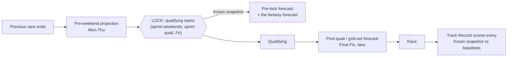
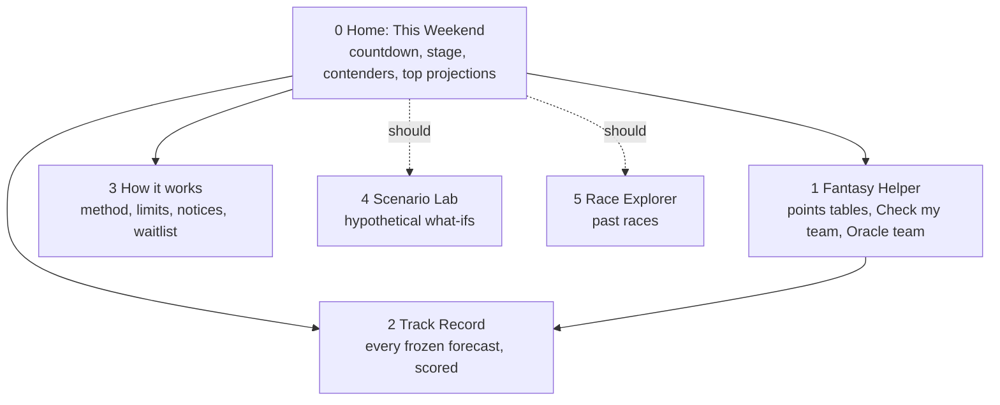

# Pitstop Oracle: MVP spec (workstream C, gate G2)

**Author:** workstream C session (Claude), for Siddharth Bisht. **Date:** 2026-11-09.
**Status:** proposal for G2 approval (target 2026-12-15). Nothing here is built yet. App changes belong to workstream E; model changes to workstream D.
**Read with:** [`ROADMAP_2027.md`](ROADMAP_2027.md) (master plan), [`PRD_v3.md`](PRD_v3.md), [`MARKET_RESEARCH.md`](MARKET_RESEARCH.md) (its "market-check view" is superseded: no betting features), [`EXP-004`](../experiments/EXP-004-market-benchmark.md), [`ML_LAUNCH_READINESS.md`](../ML_LAUNCH_READINESS.md).

Labels used throughout: **[today]** = exists in the current app, **[MVP]** = proposed for launch, **[later]** = future work.

---

## Executive summary

1. **What we are.** *An unofficial F1 forecast and fantasy helper that shows its homework.* Before F1 Fantasy teams lock (at the start of qualifying), we tell players who is likely to score well, with honest uncertainty, and we publish every forecast with a timestamp so anyone can check our record.
2. **What we are not.** No betting (no odds, no market comparison, no bookmaker links, no "tips" or "value"). Not affiliated with Formula 1 or the F1 Fantasy game. No claim that we beat the starting grid, the betting market, or predict retirements. The data doesn't support those claims (EXP-004, ML readiness audit).
3. **Who for.** Three personas: **Casual fantasy player** (5 minutes before lock), **Fantasy min-maxer** (3 teams, spreadsheets, chips), **Data-curious fan** (wants the "why" and the track record). The first two are the launch audience. The pre-lock forecast and **projected fantasy points** are the single most important output.
4. **Launch features (must).** Weekend hub with lock countdown and forecast stage; driver and constructor projected fantasy points (with a range); "Check my team" with suggested transfers and 2X Boost pick; post-qualifying update; **public, timestamped Track Record**; How it works and limits; email waitlist. **Should:** Scenario Lab (rain/penalty what-ifs, clearly hypothetical), Race Explorer, CSV export. **Later:** chip planner, price-change predictor, accounts, leagues, paid tier.
5. **Pages.** Six Streamlit pages, down from a confusing four-plus-landing: Home/This Weekend → Fantasy Helper → Track Record → How it works, plus Scenario Lab and Race Explorer. Model Performance merges into Track Record; Fantasy Lab splits into Fantasy Helper (real) and Scenario Lab (hypothetical).
6. **Uncertainty.** Until ML gate G3 passes (calibration fixed), win and podium chances are shown as **chance bands** (Favourite / Contender / Outside chance / Long shot), never as precise percentages. Projected fantasy points are shown as a rounded number with a likely range. DNF is shown only as "team retirement rate this season". Every forecast page carries a short, plain "what this model can't do" box.
7. **Money.** **Everything free at launch**, plus email capture. Decide on paid (season pass, ~£19–29 hypothesis) after six 2027 races of usage data. If we ever charge UK users, the DMCC subscription rules apply (brought forward to January 2027).
8. **Validation, starting now.** A **three-GP shadow challenge on the last three 2026 races** (Las Vegas 22 Nov, Qatar 29 Nov, Abu Dhabi 6 Dec): publish our pre-lock projections and an "Oracle" team, collect feedback. Survey (Dec) and 8–12 task-based interviews (Dec–Jan). Second usability round on the Streamlit MVP during 2027 pre-season testing (Feb).
9. **Biggest ML hand-over to D/E.** Today's fantasy points are computed from a rough heuristic, ignore qualifying points before qualifying, and use out-of-date scoring values. The model must output **full finish- and qualifying-position distributions from the Monte Carlo**, and fantasy points must be computed from those same simulated races, under a versioned 2026/2027 scoring-rules file. See section 9.
10. **Decisions needed from Siddharth:** see section 10.2. The most urgent: will you run the three-GP shadow challenge from 22 Nov, and can you name 5–10 fantasy players to interview?

---

## 0. What today's app looks like (from running it, 2026-11-09)

I ran `dashboard-anaconda` and walked through every page with the 2026 Las Vegas GP (round 21, pre-qualifying) loaded.

| Page [today] | What it shows | Problems for the MVP |
|---|---|---|
| Landing (`app.py`) | Title, "next up" line, a table of pages | Promises a "fantasy optimizer" and "markets". No lock time, no forecast. A dead-end page. |
| This Weekend | Hero cards (model pick 25.3%, pole pick, championship leader, phase), "why" bullets, win and podium charts, fantasy chart, a chart titled **"Weekend markets"**, a full table with decimals (Win %, Podium %, DNF %, Fantasy), accuracy journal | "Markets" is betting language. Decimals over-state precision. DNF % reads as a prediction. Accuracy journal says **model hit 33% vs pole 67%** over the last 12 races with no context, right under the pick. Developer controls ("Normalize win probabilities") are user-facing. |
| Race Explorer | Pick any past GP, model vs result banner, table | Fine for the data-curious fan. Doesn't say whether a race was a real pre-race forecast or a replay. |
| Fantasy Lab | Optimizer (strategy, budget slider) + what-if tab | `fantasy_prices.csv` is empty, so every driver costs $10M and every team $15M. The "best" team came out at **$80M for 50.9 points**. Subtitle says "Official-style". What-ifs are mixed into the fantasy page. |
| Model Performance | Tabs for pre-quali, post-quali, walk-forward; train (in-sample) and 2026 numbers side by side | Too technical for fans. In-sample "53.2% hit" sits next to the honest 21.1%. Labels like `test_rf_*` are misleading (ML audit, item 7). |

The bones are good: stage labels, "why" bullets, walk-forward accuracy journal, grid-penalty callouts and live forecast snapshots (`ml/reports/forecasts/`) all exist. The MVP is mostly **reframing and fixing fantasy points**, not new modelling.

---

## 1. Positioning

### 1.1 Statement

> **For** F1 Fantasy players and engaged F1 fans **who** want a smarter view of the race weekend before their team locks, **Pitstop Oracle is** an unofficial forecast and fantasy helper **that** turns a race-outcome model into projected fantasy points, with honest uncertainty and a public, timestamped track record. **Unlike** fantasy tools that work from prices and past points, or AI predictors that never show their misses, **we** publish every forecast before the lights go out and score ourselves against simple baselines, wins and misses alike.

Tagline options (test in the survey): *"The F1 model that shows its homework."* / *"Know your picks before the lock."*

### 1.2 What we will not do

| We won't | Why | Where it shows up |
|---|---|---|
| Any betting feature: odds, market comparison, "value", tips, bookmaker or affiliate links, "bet now" or "lock of the week" language | Owner decision at G1: zero gambling-compliance burden. Also, the model loses to the market (EXP-004: post-quali log-loss 1.485 vs market 1.172). | Copy review checklist (section 5.4). Market data stays an internal benchmark only. |
| Claim to be official, or imply endorsement by Formula 1, FOM, the FIA, teams or the F1 Fantasy game | Trademark risk (section 7.3); also simply untrue. | "Unofficial" in the Fantasy Helper title and footer; no F1 logos or team logos. |
| Claim we "beat the grid" or "beat the experts" | Post-quali beats the grid only inside the noise over 91 races (1.443 vs 1.488) and **loses in 2026** (1.637 vs 1.617). | Track Record shows the comparison as data, with the 2026 result in plain sight. |
| Claim we predict retirements (DNFs) | DNF ROC-AUC 0.55 overall, 0.51 in 2026: a coin flip. | DNF is "team retirement rate this season", context only. |
| Call our probabilities "well-calibrated" before G3 | Post-quali favourites at 50%+ win 39% of the time vs 63% predicted. | Chance bands instead of percentages (section 5). |
| Scrape the F1 Fantasy site or app | Their terms; also brittle. | Prices entered manually each week (section 9.5). |

### 1.3 What we *can* honestly say at launch

- "Every forecast is published before the session it predicts, with a timestamp. Here's every one we've made." (Track Record.)
- "Forecasts are tested on races the model hadn't seen." (Walk-forward.)
- "Before qualifying, the model is clearly better than recent form alone." (1.803 vs 2.403 log-loss.)
- "After qualifying, the starting grid is hard to beat; we're roughly level with it, and behind it so far in 2026."
- Once validated on 2026 shadow races: "Our projected fantasy points vs a simple baseline: here's the record." (Only if D shows it; see section 9.4.)

---

## 2. Personas and race-weekend jobs

### 2.1 F1 Fantasy rules that drive the design (2026 season)

| Rule (2026) | Value | Source |
|---|---|---|
| **Lock time** | Changes allowed "right up until Qualifying begins on Saturday" | [Formula1.com, 24 Feb 2026](https://www.formula1.com/en/latest/article/boost-the-fun-with-friends-and-family-this-season-f1-fantasy-is-back.2xVBBN90riZiaYXeYhOe0Z) |
| Sprint-weekend lock | Believed to be the start of **Sprint Qualifying (Friday)**, since sprint points count. **Not confirmed** by the sources I could fetch: verify on the in-game rules before building the countdown. | — |
| Budget and team | $100M cost cap; 5 drivers + 2 constructors | [Formula1.com](https://www.formula1.com/en/latest/article/boost-the-fun-with-friends-and-family-this-season-f1-fantasy-is-back.2xVBBN90riZiaYXeYhOe0Z) |
| Teams per account | Up to 3 | [Formula1.com](https://www.formula1.com/en/latest/article/boost-the-fun-with-friends-and-family-this-season-f1-fantasy-is-back.2xVBBN90riZiaYXeYhOe0Z) |
| Transfers | 2 free per round; only the **net** change counts in 2026; each extra transfer costs −10 points | [Formula1.com](https://www.formula1.com/en/latest/article/boost-the-fun-with-friends-and-family-this-season-f1-fantasy-is-back.2xVBBN90riZiaYXeYhOe0Z); [FanAmp 2026 rules](https://www.fanamp.com/articles/f1-fantasy-2026-rules-scoring-and-whats-changed-this-season); [Motorsport Magazine guide](https://www.motorsportmagazine.com/articles/single-seaters/f1/f1-fantasy-qatar-gp-top-tips-picks-and-predictions) |
| Boost | Pick one driver each week for **2X** points | [Formula1.com](https://www.formula1.com/en/latest/article/boost-the-fun-with-friends-and-family-this-season-f1-fantasy-is-back.2xVBBN90riZiaYXeYhOe0Z) |
| Chips | Six, each once a season, one per weekend: **Autopilot** (2X moves to your top scorer), **Extra/3X Boost** (triple one driver), **No Negative**, **Wildcard** (unlimited transfers within budget), **Limitless** (unlimited transfers, no budget, team reverts after), **Final Fix** (one change after the lock, before the race) | [Motorsport Magazine (2025 list)](https://www.motorsportmagazine.com/articles/single-seaters/f1/f1-fantasy-chips-what-they-are-and-when-to-use-them/); 2026 "the six chips return" per [FanAmp](https://www.fanamp.com/articles/f1-fantasy-2026-rules-scoring-and-whats-changed-this-season) |
| Prices | Change after each race based on recent performance; minimum price cut to $3M in 2026 | [FanAmp 2026](https://www.fanamp.com/articles/f1-fantasy-2026-rules-scoring-and-whats-changed-this-season); [Motorsport Magazine](https://www.motorsportmagazine.com/articles/single-seaters/f1/f1-fantasy-qatar-gp-top-tips-picks-and-predictions) |
| Driver scoring (race) | Finish 25-18-15-12-10-8-6-4-2-1; ±1 per position gained/lost vs grid; +1 per overtake; fastest lap +10; Driver of the Day +10; DNF −20; DSQ −25 | [Motorsport Magazine (2025; "other scoring unchanged" in 2026)](https://www.motorsportmagazine.com/articles/single-seaters/f1/f1-fantasy-qatar-gp-top-tips-picks-and-predictions) |
| Driver scoring (qualifying) | Pole 10 down to P10 1; no time set −5; DSQ −15 | same |
| Sprint | 8 down to 1 for P1–P8; Sprint DNF reduced from −20 to **−10** in 2026 | [FanAmp 2026](https://www.fanamp.com/articles/f1-fantasy-2026-rules-scoring-and-whats-changed-this-season) |
| Constructors | Sum of both drivers (excluding DOTD), plus qualifying bonus (neither in Q2 −1, one in Q2 +1, both +3, one in Q3 +5, both +10) and pit-stop points (0 to +20 by stop time, +5 fastest stop) | [Motorsport Magazine](https://www.motorsportmagazine.com/articles/single-seaters/f1/f1-fantasy-qatar-gp-top-tips-picks-and-predictions) |

Sources disagree on a few figures across seasons (pit-stop bands, transfer penalty wording). Treat the table as the working assumption and confirm against the in-game rules page.

**What this means for us.**
- The **pre-lock forecast is the product** for fantasy players. It must exist, frozen and timestamped, before qualifying (before sprint qualifying on sprint weekends). Before lock, qualifying and the grid are unknown, so qualifying points and positions gained must come from a *forecast* of qualifying, not from the actual result.
- The post-qualifying forecast still matters for fantasy: **Final Fix** allows one change after the lock, and fans want it.
- Qualifying points (up to 10), DNF (−20) and constructor Q2/Q3 bonuses are big swings. Today's code gets several of these wrong (section 9.3).

**Unknown for 2027 (check when the game relaunches, likely late February 2027):** lock rules on sprint weekends; whether chips change again (2026 renamed or reworked the boost chip); scoring values (DNF, sprint DNF, overtakes, pit-stop bands); price-change formula and price floor; number of free transfers; whether teams-per-account stays at 3. **Design rule:** keep every scoring value in one versioned rules file so a 2027 change is a config edit, not a code change.

### 2.2 Personas

#### Persona A: "Priya", casual fantasy player (launch audience, the biggest group)
- Plays one team in a mini-league with friends or colleagues. Follows F1 on TV and social media. Spends **5–10 minutes** on her team, usually Saturday morning, sometimes forgets until the last hour.
- Doesn't know or care what log-loss is. Uses the 2 free transfers most weeks, picks her 2X driver by gut feel.
- **Quote:** "Just tell me if my team is OK and who to boost."
- **Success for her:** she makes her changes in under 5 minutes and doesn't feel stupid on Sunday night.

#### Persona B: "Tom", fantasy min-maxer (launch audience, smaller but vocal and influential)
- Runs **3 teams**, is in public leagues, posts "rate my team" on r/fantasyF1, uses F1 Fantasy Tools and a spreadsheet. Plans chips weeks ahead.
- Wants numbers he can paste into his own sheet, and wants to know *how* the projection is built so he can decide when to ignore it.
- **Quote:** "Give me per-driver expected points with a spread, constructors too, and let me export it. Then show me how your projections did last week."
- **Success for him:** our projections become one input in his weekly process, and he trusts them because he's seen the record.

#### Persona C: "Alex", data-curious fan (secondary audience, the PRD's original user)
- Doesn't play fantasy (or barely). Watches every race, listens to podcasts, likes the "why".
- **Quote:** "Who's actually in with a shout this weekend, why, and is your model any good?"
- **Success for Alex:** understands the contenders and the uncertainty, comes back after qualifying, shares the Track Record page.

### 2.3 Jobs across a race weekend

Normal weekend (sprint weekends shift the lock to Friday, see 2.1).

| When | Priya (casual) | Tom (min-maxer) | Alex (fan) | Our output [stage] |
|---|---|---|---|---|
| Sun night–Thu (after the last race) | — | Review how his teams and our projections scored; plan transfers and chips; note price changes | Check how the last forecast did | Track Record update; early **pre-weekend** projection |
| Fri (practice) | — | Refine plan | Read the contenders | Pre-weekend projection (the model uses no practice data today, so it doesn't change) |
| **Sat, before qualifying = LOCK** | **"Is my team OK? Who to swap? Who gets 2X?"** | **Finalise 3 teams; projected points with ranges; export** | Who's favourite before qualifying | **Pre-lock forecast, frozen and timestamped** (the key moment) |
| Sat, after qualifying | Look at how her team qualified | Decide on Final Fix chip | "How does the grid change things?" | **Post-qualifying / grid-set forecast** |
| Sun, before the race | — | Final Fix if used | Last look before lights out | Grid-set forecast, final snapshot |
| Sun, after the race | Score check (in the official app) | Compare actual vs projected points | Did the model get it right? | Track Record scores the frozen forecasts |



---

## 3. Feature list

**Resolving the PRD conflict.** The v3 PRD says "no claim that Fantasy Lab is an official F1 fantasy optimizer" and suggests renaming Fantasy Lab to Scenario Lab. The roadmap now makes us a fantasy helper. Resolution:
- We build an **unofficial fantasy helper** and say so. The page is titled **"Fantasy Helper (unofficial)"**, with the line *"Not affiliated with Formula 1 or the official F1 Fantasy game. Scoring follows the published 2026 rules as we understand them; check the official game."* We never say "official-style" or "optimizer guarantees".
- **What-ifs move to a separate Scenario Lab page** (rain, grid penalty), labelled *hypothetical*. They never feed the Fantasy Helper's projections or the Track Record.

### 3.1 Must (launch, G4)

| ID | Feature | What it is | Persona jobs |
|---|---|---|---|
| M1 | **Weekend hub** | Home page: next GP, circuit, date, **lock countdown** (local time), forecast stage chip, generated-at time, data-as-of time, model version, data warnings (e.g., "official grid not published yet") | All: "what's the state of this weekend?" |
| M2 | **Contenders view** | Drivers ranked, with win and podium **chance bands** (section 5), points-finish chance, "why" bullets for the top 3 (reuse `driver_insight_bullets`), grid-penalty callouts (reuse) | Alex: who's in with a shout and why; Priya: who's strong |
| M3 | **Projected fantasy points: drivers** | Table: driver, team, price (manual), projected points (rounded), likely range (low–high), points per $M, chance of Q3, chance of a points finish, team retirement rate (context) | Priya: who scores; Tom: numbers with a spread |
| M4 | **Projected fantasy points: constructors** | Same, including qualifying bonus and pit-stop estimate (labelled "rough" if pit-stop data is weak) | Tom; Priya (picking 2 constructors) |
| M5 | **Check my team** | Pick your 5 drivers + 2 constructors (multiselects) → your projected total and range; suggested transfers using up to 2 free (and showing the −10 cost of a third); suggested 2X Boost driver; budget check. No accounts: nothing is saved server-side. | **Priya's core job**; Tom for each of his teams |
| M6 | **Suggested team ("Oracle team")** | The highest-projected valid team under $100M (existing optimizer, fixed prices and scoring). Labelled as a projection, not advice. Published publicly each weekend as part of the record. | Priya (fresh start/Wildcard); marketing; honest live demo |
| M7 | **Post-qualifying update** | Same contenders and points views after qualifying and again when the official grid is published (existing stages) | Alex; Tom's Final Fix decision |
| M8 | **Track Record (public, timestamped)** | Every frozen forecast (pre-lock and grid-set), with UTC timestamp and model version, scored after the race: winner pick, the winner's chance band, log-loss vs grid and prior-form baselines, and **projected vs actual fantasy points** vs a simple baseline. Misses shown as prominently as hits. Season summary at top. Includes the 2026 shadow races. Downloadable CSV. | Trust for all; Tom's post-race review; Alex sharing |
| M9 | **How it works and limits** | Plain-language method (one screen), "what this model can't do" list, glossary, data sources and credits, unofficial/trademark notice, privacy note | Trust; Alex |
| M10 | **Email waitlist / updates** | One field + consent checkbox ("weekly pre-lock email, unsubscribe any time") on Home and How it works. Uses an external form or email tool (E chooses). | Validation; future paid tier |
| M11 | **Reliability basics** | Clear empty/error states ("forecast not published yet: next run Fri 18:00 UTC"), stale-data warning if older than expected, forecast snapshot written before lock automatically | All; G4 condition |

### 3.2 Should (launch if time allows, else first weeks of the season)

| ID | Feature | Persona jobs |
|---|---|---|
| S1 | **Scenario Lab** (from today's what-if tab): rain and grid-penalty toggles, baseline vs scenario side by side, labelled *hypothetical*, rain explained as an assumption (the model has no weather signal) | Alex: "what if it rains?"; Tom: hedging |
| S2 | **Race Explorer** (keep): past races, clearly marking "replay with today's model" vs "real pre-race forecast" | Alex |
| S3 | **CSV export / copy table** of projected points (drivers and constructors) | Tom |
| S4 | **Sprint-weekend view**: sprint and GP points split, earlier lock flagged loudly | Tom, Priya |
| S5 | Driver detail expander: points breakdown by source (qualifying, race, positions gained, sprint, retirement risk) | Tom: "why is this number what it is?" |
| S6 | Chip hint, rules-based only: e.g., "sprint weekend: more points available, a common time for 3X Boost or Limitless" (no model claim) | Priya, Tom |

### 3.3 Later (after launch, only if validated)

Chip planner across the season; price-change predictor; saved teams and accounts; multiple teams side by side; public "Oracle vs community" leagues inside the app; push or email alerts ("lock in 2 hours, your 2X driver changed"); creator/publisher embeds and API; head-to-head driver projections; paid tier (section 7); the FastAPI + React web app (roadmap, from April 2027).

### 3.4 Won't (any tier)

Odds, market comparison, bookmaker links, tips/"value"/"lock" language, DNF predictions as a feature, official logos or imagery, scraping the official game.

---

## 4. Information architecture (Streamlit MVP)

### 4.1 Page list and mapping to today

| # | MVP page | Tier | From today | Change |
|---|---|---|---|---|
| 0 | **Home: This Weekend** (`app.py`) | Must | Landing + This Weekend | **Merge.** The landing page becomes the weekend hub, so the first screen has the forecast. |
| 1 | **Fantasy Helper (unofficial)** | Must | Fantasy Lab, optimizer tab; fantasy table from This Weekend | **Rename + rework.** Projected points tables, Check my team, Oracle team. |
| 2 | **Track Record** | Must | Accuracy journal (This Weekend) + Model Performance | **New page, merge.** Fan-facing record on top; technical details (calibration, log-loss tables, all seasons) in expanders. |
| 3 | **How it works** | Must | `disclaimer_footer`, scattered captions | **New.** Method, limits, glossary, notices, waitlist. |
| 4 | **Scenario Lab** | Should | Fantasy Lab, what-if tab | **Split out**, labelled hypothetical. |
| 5 | **Race Explorer** | Should | Race Explorer | **Keep**, minor label fixes. |
| — | Model Performance | — | Model Performance | **Retired as a page**; content moves into Track Record expanders. |

Removed from user view: the "Normalize win probabilities" checkbox and the logistic-regression model radio (developer controls; keep them behind a `?dev=1` flag or remove). The "Weekend markets" chart is renamed "Win and podium chances" and redrawn as bands.



### 4.2 What's on each page (content order = priority order)

**0. Home: This Weekend**
1. Header: GP name, circuit, local date; **lock countdown**; stage chip (Pre-weekend / **Pre-lock** / Post-qualifying / Grid set / Race finished).
2. Freshness line: "Forecast generated Sat 09:12 UTC · data as of Fri 18:00 UTC · model v3.2".
3. Three cards: Top projected driver (points + range), Favourite to win (band, not %), Starting grid status.
4. Contenders: ranked list with chance bands for win and podium, points-finish chance, "why" bullets for the top 3.
5. "What this model can't do" box (short, always visible; section 5.3).
6. Link cards: Fantasy Helper, Track Record ("Last race: we had the winner as a Contender"), waitlist.

**1. Fantasy Helper (unofficial)**
1. Title + unofficial notice + lock countdown + stage chip. If prices are missing: a blocking warning, not silent defaults.
2. Tabs: **Drivers** | **Constructors** | **Check my team** | **Oracle team**.
3. Drivers/Constructors: sortable table (projected points, range, $M, points per $M, Q3 chance, points-finish chance, team retirement rate). Sprint weekends: sprint vs GP columns.
4. Check my team: pickers → your projection → suggested transfers (≤2 free, the third shown with −10) → suggested 2X.
5. Oracle team: lineup, total projection and range, "published at" timestamp.
6. Footnote: scoring-rules version, "projections, not advice".

**2. Track Record**
1. Season summary tiles: forecasts published on time (n/n), winner in our Favourite band (x of n), projected-points accuracy vs baseline, model vs grid (log-loss, in words: "level", "slightly better", "worse").
2. Race-by-race table, newest first: race, snapshot time, stage, our favourite, actual winner, winner's band, Oracle team projected vs actual points, ✓/✗. Click → frozen forecast as published.
3. "How to read this" box.
4. Expanders: calibration chart ("when we said Favourite, how often did they win?"), log-loss tables pre/post quali, historical walk-forward 2022–26 (labelled "back-tested, not live"), model versions changelog.
5. CSV download.

**3. How it works**
1. "In one minute": the model ranks drivers from recent car and driver pace, qualifying and grid, then simulates the race thousands of times. Fantasy points are counted in each simulated race and averaged.
2. Limits list (section 5.3).
3. Glossary: projection, range, chance band, log-loss ("our surprise score"), walk-forward, baseline.
4. Data sources and credits (Jolpica, OpenF1, Open-Meteo), scoring-rules version.
5. Notices: unofficial; trademarks; not betting advice; privacy.
6. Waitlist form.

---

## 5. Showing uncertainty to non-experts

### 5.1 Options considered

| Format | Example | Good for | Risk | Verdict |
|---|---|---|---|---|
| Precise % | "Antonelli 25.3% to win" | Experts | Implies precision we don't have; our 50%+ favourites win only 39% | **Not before G3.** After G3: whole numbers only. |
| Natural frequency | "Wins about 1 in 4 races like this" | Casual fans understand it best | Still a number | Use as hover/helper text after G3 |
| **Chance bands (tiers)** | "Favourite", "Contender" | Everyone; survives calibration error | Hides detail Tom wants | **Default for win and podium at launch** |
| **Range** | "18 pts (likely 6–31)" | Fantasy points, where spread matters | Needs the full simulated distribution | **Default for projected points** |

### 5.2 Which numbers we may show

| Output | Before G3 (now) | After G3 passes | Never |
|---|---|---|---|
| Win chance | Band only + rank | Band + whole-number % + "about 1 in N" | Decimals; "sure thing" |
| Podium chance | Band only | Band + whole-number % | |
| Points-finish (top 10) chance | Band, unless D shows calibration within ±10 points per bucket on walk-forward, then whole % | Whole % | |
| Q3 / qualifying position | "Likely Q3" / "Borderline" / "Unlikely" | Whole %; likely grid range "P3–P7" | |
| Projected fantasy points | Rounded whole number + likely range (10th–90th percentile), **only once computed from the simulation** (section 9) | Same + accuracy vs baseline badge if earned | Decimals; "guaranteed points" |
| DNF | "Team retirement rate this season: 1 in 9 races" (context) | Same, unless DNF ROC-AUC > 0.6 | "Predicted to retire" |
| Model accuracy | Track Record with baselines, both ways | Same | "Beats the grid/experts/bookies" |

**Band definitions (win chance; tuned to the known over-confidence):**

| Band | Model win chance | Colour | Copy |
|---|---|---|---|
| Favourite | ≥ 30% | strong | "Favourite" |
| Contender | 10–30% | medium | "In contention" |
| Outside chance | 3–10% | light | "Needs things to go their way" |
| Long shot | < 3% | grey | "Long shot" |

There is deliberately **no "strong favourite" band** above 50% until calibration is fixed: those drivers won 39% of the time, not 63%. Podium bands: Likely (≥ 60%), Possible (25–60%), Outside chance (5–25%), Unlikely (< 5%). D should re-check the band boundaries against the calibration table each release.

### 5.3 Showing model limits honestly (PRD transparency principle)

An always-visible box on Home and Fantasy Helper, three lines, linking to How it works:

> **What this model can't do (yet).** It doesn't use practice times or weather, so rain and big setup changes surprise it. After qualifying, the starting grid is about as good a guide as we are, and better so far in 2026. It can't predict retirements; we show each team's retirement rate instead. [Our full record →]

Other rules:
- Every forecast shows its stage, generated-at and data-as-of times.
- When the stage is stale (e.g., qualifying finished but the post-quali forecast hasn't run), show a warning, not the old forecast as if current.
- The Track Record leads with the honest comparison, including 2026.
- Ranges are always visible next to projected points, not in a tooltip.

### 5.4 Wording guide

| Use | Avoid (betting or overclaim) |
|---|---|
| chance, projected, forecast, likely range, in contention | odds, price (for chances), value, edge, tip, banker, lock (as in "sure pick"), bet, stake, "beat the bookies" |
| "the model projects", "our forecast" | "will win", "guaranteed", "can't lose" |
| "Oracle team" (a projection) | "best bet", "must-have" |
| "unofficial helper for F1 Fantasy players" | "official", "F1's", "Formula 1 approved" |

"Lock" is the game's own word for the deadline; use it only as "team lock" / "lock countdown".

---

## 6. Wireframes (must-have pages)

ASCII, desktop width. Streamlit's left sidebar holds the page list. Numbers are illustrative only.

### 6.1 Home: This Weekend (pre-lock stage)

```
┌───────────────┬──────────────────────────────────────────────────────────────────┐
│ PITSTOP ORACLE│  LAS VEGAS GRAND PRIX · Las Vegas Strip Circuit · race 22 Nov (UTC)   │
│               │  [● PRE-LOCK FORECAST]   Team lock in 1d 04h 12m (qualifying start) │
│ ▸ This Weekend│  Generated Fri 21 Nov 09:12 UTC · data as of Thu 18:00 UTC · model v3.2│
│   Fantasy     ├──────────────────────┬───────────────────────┬────────────────────┤
│   Helper      │ TOP PROJECTED DRIVER │ FAVOURITE TO WIN      │ STARTING GRID      │
│   Track Record│ Antonelli            │ Antonelli             │ Not set yet        │
│   How it works│ 24 pts (likely 8–38) │ ▇▇▇▇ Favourite        │ Qualifying Sat     │
│   ─────────── ├──────────────────────┴───────────────────────┴────────────────────┤
│   Scenario Lab│ CONTENDERS                                                        │
│   Race        │ #  Driver        Team       Win            Podium     Top 10      │
│   Explorer    │ 1  Antonelli     Mercedes   ▇▇▇▇ Favourite  ▇▇▇ Likely  ▇▇▇ Likely │
│               │ 2  Russell       Mercedes   ▇▇▇ Contender   ▇▇ Possible ▇▇▇ Likely │
│ ┌───────────┐ │ 3  Norris        McLaren    ▇▇▇ Contender   ▇▇ Possible ▇▇▇ Likely │
│ │Weekly pre-│ │ 4  Piastri       McLaren    ▇▇ Outside      ▇▇ Possible ▇▇▇ Likely │
│ │lock email │ │ …  (show all 22 ▾)                                                │
│ │[email   ] │ │                                                                   │
│ │[ ] I agree│ │ Why Antonelli?  · Car within 0.3% of pole pace recently           │
│ │[Join]     │ │                 · Averaging P2.2 over the last 5 races            │
│ └───────────┘ ├───────────────────────────────────────────────────────────────────┤
│               │ ⓘ WHAT THIS MODEL CAN'T DO (YET): no practice or weather data;    │
│               │ after qualifying the grid is about as good a guide as we are;     │
│               │ can't predict retirements.            [Our full record →]         │
│               ├──────────────────────┬────────────────────────────────────────────┤
│               │ [Fantasy Helper →]   │ [Track Record → last race: winner was our  │
│               │ Check my team        │  Contender, Oracle team 142 vs 131 proj.]  │
│               └──────────────────────┴────────────────────────────────────────────┤
│ Unofficial. Not affiliated with Formula 1. Not betting advice.   How it works     │
└──────────────────────────────────────────────────────────────────────────────────┘
```

Post-qualifying variant: stage chip becomes **POST-QUALIFYING** (or **GRID SET** once the official grid is in), the grid card shows pole and penalties (reuse `render_grid_banner`), and a banner reads "Team lock has passed. Final Fix users: one change allowed before the race."

### 6.2 Fantasy Helper (unofficial): Drivers tab

```
┌──────────────────────────────────────────────────────────────────────────────────┐
│ FANTASY HELPER (UNOFFICIAL)          Lock in 1d 04h 12m   [● PRE-LOCK]           │
│ Not affiliated with Formula 1 or the official F1 Fantasy game. Scoring: 2026      │
│ rules v2026.1 as we understand them. Prices entered Thu 20 Nov.                   │
│ [ Drivers ] [ Constructors ] [ Check my team ] [ Oracle team ]                    │
├──────────────────────────────────────────────────────────────────────────────────┤
│ Sort by: (•) Projected pts  ( ) Pts per $M      [⬇ Download CSV]                 │
│ Driver      Team      $M    Projected  Likely range  Pts/$M  Q3       Top 10  Retire│
│ Antonelli   Mercedes  28.1     24        8 – 38       0.85   Likely   Likely  1 in 12│
│ Norris      McLaren   29.0     21        5 – 35       0.72   Likely   Likely  1 in 14│
│ Hadjar      RB        9.8      11       -4 – 22       1.12   Border.  Possible 1 in 8│
│ …                                                                                 │
│ ▸ How is "Projected" worked out? (expander: points by source for any driver:      │
│   qualifying 6.1 · race finish 12.4 · positions gained 1.2 · retirement risk -1.6)│
├──────────────────────────────────────────────────────────────────────────────────┤
│ ⓘ Projections, not advice. Ranges cover 8 in 10 simulated races.                  │
└──────────────────────────────────────────────────────────────────────────────────┘
```

If `fantasy_prices.csv` has no rows for this round: replace the table's price columns with "Prices for this round not entered yet" and hide Pts/$M, Check my team budget check and Oracle team. Never fall back silently to $10M defaults.

### 6.3 Fantasy Helper: Check my team tab

```
┌──────────────────────────────────────────────────────────────────────────────────┐
│ CHECK MY TEAM                         Nothing is saved. Lock in 1d 04h 12m        │
│ Drivers (pick 5):  [Norris ×][Russell ×][Hadjar ×][Bearman ×][Albon ×]  ▾          │
│ Constructors (2):  [McLaren ×][Williams ×]  ▾                                     │
│ Free transfers left: (•) 2  ( ) 1  ( ) 0       Budget: $100.0M                    │
├───────────────────────────────┬──────────────────────────────────────────────────┤
│ YOUR TEAM                     │ SUGGESTED CHANGES (using up to 2 free transfers) │
│ Projected  96 pts             │ 1. Albon → Antonelli    +13 pts   cost +$9.4M ✗  │
│ Likely     61 – 128           │    (over budget; next best:)                     │
│ Cost       $97.6M  ✓          │ 1. Albon → Lawson        +4 pts   cost -$0.6M ✓  │
│                               │ 2. Williams → Mercedes  +9 pts   cost +$1.9M ✓  │
│ 2X BOOST: Norris (21 pts)     │ After changes: 109 pts (likely 72–140)           │
│ (highest projection on team)  │ A 3rd transfer would cost −10 pts: not worth it  │
│                               │ unless it gains more than 10.                    │
├───────────────────────────────┴──────────────────────────────────────────────────┤
│ ⓘ Projections, not advice. Chips (Wildcard, Limitless, Final Fix…) not modelled.  │
└──────────────────────────────────────────────────────────────────────────────────┘
```

Oracle team tab: same layout as "Your team" with the optimizer's lineup, "Published Fri 21 Nov 09:12 UTC", and a link to its record on Track Record.

### 6.4 Track Record

```
┌──────────────────────────────────────────────────────────────────────────────────┐
│ TRACK RECORD    Every forecast is saved before the session it predicts and never  │
│                 edited. Here is every one, scored.             [⬇ Download CSV]   │
├───────────────┬───────────────┬────────────────────────┬────────────────────────┤
│ ON TIME       │ WINNER IN OUR │ ORACLE TEAM vs         │ VS STARTING GRID       │
│ 9 / 9 races   │ TOP 2 BANDS   │ "LAST-3 AVG" BASELINE  │ (after qualifying)     │
│ before lock   │ 7 of 9        │ 6 of 9 races better    │ Level (2026: worse)    │
├───────────────┴───────────────┴────────────────────────┴────────────────────────┤
│ Race            Snapshot (UTC)   Stage     Our favourite  Winner     Winner band │
│ 2027 R3 Japan   Sat 05:41  🔒    Pre-lock  Norris         Russell    Contender  ✗│
│                 Sun 04:30        Grid set  Russell        Russell    Favourite  ✓│
│ 2027 R2 China   …                                                                 │
│ 2026 R23 AbuDh. (shadow test, pre-launch) …                                       │
│   ▸ open frozen forecast as published                                             │
│ Oracle team: projected 131 (likely 92–170) · actual 142 · baseline team 118       │
├──────────────────────────────────────────────────────────────────────────────────┤
│ ▸ How to read this   ▸ When we said "Favourite", how often did they win?          │
│ ▸ Technical: log-loss vs grid and prior form, pre and post qualifying             │
│ ▸ Back-tested 2022–2026 (simulated, not live)   ▸ Model versions                   │
└──────────────────────────────────────────────────────────────────────────────────┘
```

### 6.5 How it works

```
┌──────────────────────────────────────────────────────────────────────────────────┐
│ HOW IT WORKS                                                                      │
│ In one minute: we rate each car and driver from recent races, add qualifying and  │
│ the grid when known, then simulate the race 6,000 times. Fantasy points are       │
│ counted in every simulated race; "projected" is the average, the range covers     │
│ 8 in 10 simulations.                                                              │
│ ─ What we can't do (yet) ─  · no practice or weather data · grid ≈ us after quali │
│   · retirements are a team's season rate, not a prediction · new-season surprises │
│ ─ Glossary ─  projection · likely range · chance band · baseline · walk-forward   │
│ ─ Data and credits ─  Jolpica F1 API · OpenF1 · Open-Meteo · scoring rules v2026.1│
│ ─ Notices ─  Unofficial; not affiliated with Formula 1, FOM, the FIA, any team or │
│   the F1 Fantasy game. F1, FORMULA 1 and related marks are trade marks of Formula │
│   One Licensing B.V. Not betting advice. Privacy: what we collect and why.        │
│ ─ Get the weekly pre-lock email ─  [email      ] [ ] I agree to …  [Join]         │
└──────────────────────────────────────────────────────────────────────────────────┘
```

---

## 7. Free vs paid

### 7.1 Recommendation: everything free at launch, plus email capture

- **Why.** The PRD says validate demand first; we have no users yet. The main fantasy tool already has a big free tier ([F1 Fantasy Tools pricing](https://f1fantasytools.com/pricing)). Our trust story (the Track Record) only works if lots of people see it. Streamlit has no accounts or payments, so charging would mean building infrastructure the roadmap places after launch.
- **What we measure instead of revenue:** waitlist sign-ups, weekly returning users on lock day, Check my team usage, survey willingness-to-pay.
- **Decision point:** after 2027 round 6 (about early May 2027), with the web-app plan. Paid hypothesis carried over from workstream A, minus betting features: a **season pass at ~£19–29** for Check my team across 3 teams, CSV/API export, alerts, chip planner. The free tier keeps: weekend forecast, projected points table, Oracle team, Track Record.
- Optional demand test before charging: a "Pro (coming soon): tell me when" button that logs clicks (a fake door, clearly labelled as not yet available).

### 7.2 If we charge UK users later: DMCC subscription rules

- The DMCC Act 2024 subscription regime was delayed to spring 2027 and then **brought forward to January 2027** ([Lewis Silkin on the spring delay](https://www.lewissilkin.com/insights/2026/04/02/consumer-law-update-subscriptions-regime-delayed-again-to-spring-2027-102mops); [Stephenson Harwood: brought forward to January 2027](https://shlegal.com/insights/subscription-reforms-brought-forward-to-january-2027-is-your-business-ready/); [TLT](https://www.tlt.com/insights-and-events/insight/dmcc-act-subscription-contracts-regime-brought-forward-by-the-pm-what-do-businesses-need-to-know)). Commencement regulations still need to be confirmed ⚖️.
- What it requires (summary of the above): clear pre-contract information; reminders before renewals and before a free trial or discount ends; easy cancellation (as easy as signing up); a cooling-off period after trials and long renewals.
- Practical answer: a one-off **season pass that does not auto-renew** avoids most of the regime. If auto-renewing, use a hosted billing provider that handles reminders and cancellation. Either way, a lawyer review before first charge ⚖️.

### 7.3 F1 trademark and naming cautions

- Formula 1's guidelines allow some editorial and fan use of word marks *without* a licence, where the user isn't "materially commercial", at F1's discretion; **logos are never allowed without a written licence** ([Formula 1 guidelines](https://www.formula1.com/en/toolbar/guidelines.html)). F1, FORMULA 1, FORMULA ONE, GRAND PRIX and related marks belong to Formula One Licensing B.V. ([Formula 1 legal notices](https://formula1.com/en/toolbar/legal-notices.html)). F1 has pushed back on creators using "F1" in their branding ([news.gp](https://news.gp/en/f1-vs-content-creators-using-f1-in-their-branding)).
- Rules for us:
  - **Product name, domain, logo and social handles contain no "F1" / "Formula 1"**. "Pitstop Oracle" is fine. (Note: the repo is named `pitstopOracle-F1AI`; keep that internal.)
  - Use the marks only descriptively: "a forecast helper for F1 Fantasy players", "the 2027 Japanese Grand Prix". No F1, team or game logos; no official driver photos; no F1 fonts or the red-white look-alike styling. Team colours as plain colour swatches are lower risk but ⚖️ check.
  - The unofficial/trademark notice in the footer and How it works (wireframe 6.5).
  - "F1 Fantasy" is FOM's product name; refer to it, don't brand with it.
- Data-source terms to confirm before launch (E): Jolpica and OpenF1 terms for a public (and later commercial) app; Open-Meteo's non-commercial free tier ⚖️.
- Email capture means UK GDPR applies: privacy notice, lawful basis (consent), unsubscribe. Because the audience skews young and the site is open to all ages, keep data minimal and consider the ICO Children's Code ⚖️.

---

## 8. Validation plan

Adapted from the PRD's survey, interviews and manual three-GP challenge, aimed at fantasy players.

### 8.1 Timeline

| When | Activity | Owner | Output |
|---|---|---|---|
| **22 Nov, 29 Nov, 6 Dec 2026** | **Three-GP shadow challenge** on Las Vegas, Qatar, Abu Dhabi (the last three 2026 races): before each lock, post our projected points table + Oracle team (a screenshot or simple page) to r/fantasyF1's weekly thread and a small group; enter the Oracle team in a public F1 Fantasy mini-league; after the race, post the record | Siddharth (posting), coordinator (generating) | Real reactions; first entries on the Track Record; comments to mine for wording |
| 1–20 Dec 2026 | Survey (8.2), linked from the challenge posts, FISO, fantasy Discords | Siddharth | 40–60 fantasy-player responses |
| 1 Dec 2026 – 15 Jan 2027 | 8–12 interviews with tasks (8.3), using the current app + the wireframes or HTML mockup | Siddharth (with a script below) | Task success rates, top confusions |
| 15 Dec 2026 | **G2**: approve this spec with validation results so far | Siddharth | Frozen MVP scope |
| Late Feb 2027 (pre-season testing week) | Usability round 2 on the Streamlit MVP with 5 people; soft launch to the waitlist | Siddharth, E | Fix list before the opener |
| 2027 R1–R3 | Public "Oracle vs the community" mini-league + weekly pre-lock post; on-page 1-question poll ("Did this help you pick your team?") | E, Siddharth | Launch metrics (section 10) |

The 2026 F1 Fantasy game is still running for the last three races, so the shadow challenge is real, not hypothetical. Qatar is likely a sprint weekend; good test of the earlier lock.

### 8.2 Survey (≈ 5 minutes; Google Form or Tally)

1. How do you follow F1? (every session / every race / highlights / occasionally)
2. Do you play F1 Fantasy? How many teams? Any other fantasy game? (None / official 1 team / official 2–3 teams / GridRival / FanTeam / other)
3. Your best season finish, roughly? (top 1% / top 10% / top 50% / don't know)
4. How long do you spend on your team in a typical race week? (< 5 min / 5–15 / 15–60 / > 1 hour)
5. When do you usually make your changes? (early week / Friday / Saturday before lock / I often miss the lock)
6. What tools or sources do you use? (none / F1 Fantasy Tools / FanAmp / Reddit / YouTube or podcasts / own spreadsheet / other)
7. Hardest decision each week? (rank: transfers / 2X driver / constructors / chip timing / budget and prices)
8. Which would you use weekly? (rate 1–5): projected points per driver; projected points with a likely range; "check my team" with suggested transfers; suggested 2X driver; a full suggested team; win/podium chances; a public record of past projections; what-if scenarios (rain, penalties)
9. **Comprehension check.** We show: *"Norris: 21 pts (likely 5–35)"*. What does "likely 5–35" mean to you? (free text, then multiple choice with one correct answer)
10. **Comprehension check.** A driver is labelled *"Contender"* to win. Roughly what chance is that? (< 5% / 10–30% / 50% / > 70%)
11. How much would a public record of past projections affect whether you trust a tool? (1–5)
12. Would you pay for a tool like this? (no / up to £10 a season / £10–30 / more) And which feature would make you pay? (free text)
13. Anything that would put you off? (free text)
14. Email for the shadow-challenge results and launch (optional, with consent).

### 8.3 Interviews (30–40 minutes, 8–12 people; at least 4 casual, 4 min-maxers, 2 non-fantasy fans)

Ask them to think aloud. Don't help unless stuck for 60 seconds. Record success, time and quotes.

| # | Task | Success looks like | Tests |
|---|---|---|---|
| 1 | "It's Saturday morning, lock is in two hours. Using this, decide whether to change your team." (They bring their real team.) | Enters team, reads suggestions, decides in < 5 min | M5, IA |
| 2 | "Who would you pick as your 2X driver, and why?" | Finds the suggestion and the reason | M5, S5 |
| 3 | "Find the driver giving the most points for his price." | Sorts by Pts/$M | M3 |
| 4 | "How sure is the tool about the winner this weekend?" | Explains band in their words, roughly right | Section 5 |
| 5 | "What does 'likely 5–35' mean?" | Says something like "most outcomes fall in there" | Ranges |
| 6 | "Has this tool been any good? Show me." | Finds the Track Record and reads one row correctly | M8 |
| 7 | "Qualifying just finished. What changed?" | Finds the post-quali stage | M7 |
| 8 | "What if it rains on Sunday?" | Finds Scenario Lab and notices "hypothetical" | S1 |
| 9 | Closing: "Would you use this next race? What's missing? Would you tell a friend?" | Stated intent | Demand |

Pass bars for G2/G4: tasks 1, 4, 6 completed unaided by ≥ 70% of participants; comprehension questions 9–10 ≥ 70% correct in the survey. If bands are misread, change the copy, not the model.

---

## 9. Data and ML requirements for D and E

### 9.1 Forecast stages and when each must exist

| Stage | Trigger / deadline | Inputs known | Status today |
|---|---|---|---|
| `pre_weekend` | After the previous race's results are final (Mon) | Form, standings | Same model as `pre_quali` (no practice features); can reuse |
| **`pre_lock`** (= `pre_quali`) | **Frozen snapshot ≥ 1 hour before the lock**: before GP qualifying on normal weekends, **before sprint qualifying on sprint weekends** | Form, standings, entry list, prices | `pre_quali` exists; the automated frozen snapshot does not (E) |
| `post_quali` / `grid_set` | After qualifying; again when the official grid is published | + quali, grid, penalties | Exists |
| `post_sprint` | Only once GP qualifying is also known | + sprint result | **Bug:** used before GP quali (ML audit item 4, D P1) |
| scoring | After the race result is final | results, fantasy points | `race_weekend.py after` exists for winner; fantasy scoring does not |

### 9.2 Outputs per stage

All outputs come from the **same Monte Carlo draws** (joint per simulated race), so teammates and constructor totals are consistent and ranges are real.

**Per driver**
| Output | pre_lock | post_quali | Notes |
|---|---|---|---|
| P(win), P(podium) | ✓ | ✓ | exists |
| **P(points finish, top 10)** | ✓ | ✓ | new; needs calibration table |
| **Finish-position distribution P(pos = 1…20) and P(not classified)** | ✓ | ✓ | replace the heuristic in `expected_driver_fantasy_points` |
| **Qualifying-position distribution, P(Q2), P(Q3)** | ✓ | known | new: needed for qualifying points and constructor bonus before lock |
| Sprint qualifying and sprint finish distributions | ✓ (sprint wknds) | ✓ | new |
| Expected positions gained/lost | ✓ (from simulated grid) | ✓ | today assumes grid = quali or 0 before quali |
| **Projected fantasy points: mean, p10, p50, p90, and breakdown by source** (quali, race finish, positions, overtakes, fastest lap, DOTD, DNF, sprint) | ✓ | ✓ | new |
| Team retirement rate (context) | ✓ | ✓ | exists (`EmpiricalDNFModel`) |

**Per constructor:** projected points mean/p10/p90, including Q2/Q3 bonus and a pit-stop estimate (team's recent average pit-stop points; label "rough" if the data source is weak; OpenF1 pit data to be checked by D/E).

**Hard-to-model items:** overtakes, fastest lap, Driver of the Day. MVP: use each driver's recent per-race average (or a simple model by start position) as an expectation, labelled as an estimate in the breakdown. Don't block launch on modelling them well.

**Per snapshot metadata:** season, round, stage, generated_at (UTC), data_as_of, model version, scoring-rules version, prices version, n_simulations, calibration status flag (drives whether the UI shows % or bands), content hash.

### 9.3 Fixes needed in today's fantasy code (`ml/f1ml/fantasy.py`)

| Problem | Today | Needed |
|---|---|---|
| Finish distribution | Heuristic weights `1/(1+|pos − expected_finish|)` | Simulated distribution from the Monte Carlo |
| Qualifying points before quali | 0 (quali unknown) | Expected from the quali distribution |
| Positions gained before quali | Grid defaults to quali, so ~0 | From simulated grid vs finish |
| DNF penalty | −15 | −20 (2026), from rules file |
| Fastest lap | +5 | +10 |
| Sprint DNF | −5 | −10 (2026) |
| Missing categories | — | Overtakes, DOTD, quali no-time/DSQ, race DSQ, constructor Q2/Q3 bonus, pit stops |
| Constructor points | Sum of drivers' expected points (incl. nothing team-specific) | Driver sum (excluding DOTD) + bonuses |
| Prices | Defaults ($10M / $15M) when the CSV is empty | Block the optimizer and show a warning; weekly manual entry |
| Optimizer | Greedy pool of top 14 drivers by score | Fine for MVP; add "current team + N transfers" search for Check my team |
| Rules values | Hard-coded constants | One versioned rules file (e.g., `ml/data/manual/fantasy_rules_2026.yaml`), updated for 2027 |

### 9.4 Evaluation D must report (so the UI knows what it may claim)

- Calibration tables (walk-forward) for P(win), P(podium), P(top 10), P(Q3): G3 bar is each bucket within ±10 points; this sets bands vs % (section 5.2).
- **Projected fantasy points accuracy** on walk-forward 2024–26 and live shadow races: mean absolute error and rank correlation of projected vs actual points, against two baselines: (a) driver's average fantasy points over the last 3 races; (b) price-implied ranking (if historical prices can be entered for a sample). Also: how often actual points land inside the p10–p90 range (target ≈ 80%).
- Oracle-team actual points vs a baseline team (highest last-3-average team under budget).
- Separate numbers for sprint weekends.

### 9.5 Engineering requirements for E (data side)

- Weekly manual price entry (≈ 15 minutes, Thursday) into `fantasy_prices.csv` with a simple validation script (22 drivers, 11 constructors, sum sanity). No scraping.
- Automated `pre_lock` snapshot job with lock times per weekend format; snapshot files are **append-only** (never overwritten) and committed or stored with their hash, so the Track Record is verifiable.
- Track Record reads only frozen snapshots, never re-scores with a newer model.
- Lightweight, privacy-friendly analytics for the success metrics (Streamlit has none built in).

---

## 10. Success metrics and open questions

### 10.1 Metrics

**At launch (G4, 2027 opener)**
| Metric | Target |
|---|---|
| Must features M1–M11 live | 100% |
| Track Record populated | All 3 shadow races (2026) + back-test section |
| Waitlist sign-ups before R1 | ≥ 300 (hypothesis; adjust after the shadow challenge) |
| Interview task success (tasks 1, 4, 6) | ≥ 70% unaided |

**First 6 races of 2027 (to ~early May)**
| Metric | Target | Why |
|---|---|---|
| Pre-lock forecast published on time | **6 / 6** (≥ 1 h before lock, incl. sprint weekends) | Trust is the product; a missed lock is our worst failure |
| Unique visitors on lock day | Growing race over race; ≥ 1,000 by R6 (hypothesis) | Demand |
| Returning visitors across consecutive weekends | ≥ 30% | PRD "repeat use" |
| Sessions that use Check my team | ≥ 25% | Proves the core fantasy job |
| "Did this help?" poll | ≥ 60% yes | Usefulness |
| Projected points vs last-3 baseline | Reported honestly every race; aim: lower MAE over the 6 races | Quality; we publish it either way |
| p10–p90 range coverage | 70–90% of actual driver scores | Ranges mean what they say |
| Oracle team in public mini-league | Reported weekly, no target | Honest live demo |
| Complaints about misleading claims | 0 | Positioning holds |

### 10.2 Open questions for Siddharth

1. **Three-GP shadow challenge:** will you post our pre-lock table and Oracle team for Las Vegas (22 Nov), Qatar (29 Nov) and Abu Dhabi (6 Dec)? About 1–2 hours per weekend. Under your name or a project account?
2. **Interviews:** can you name 5–10 F1 Fantasy players (friends, colleagues, mini-league mates) by 1 December?
3. **Price entry:** are you OK entering F1 Fantasy prices by hand each Thursday (≈ 15 min), or should we find someone?
4. **Honesty on 2026:** comfortable stating on the Track Record that the grid beat us after qualifying in 2026? (Recommended: yes; it is our differentiator.)
5. **Waitlist tool and analytics:** any preference (e.g., a form tool vs an email service; Plausible-type analytics)? Any budget?
6. **Domain and name:** happy with "Pitstop Oracle" and a domain without "f1"? Check availability.
7. **Legal review:** budget for a short UK review (trademark use, GDPR/children's code, later DMCC) before launch?
8. **Multiple teams:** must Check my team handle 3 teams at launch, or is one at a time fine? (Spec assumes one at a time.)
9. **Partnership:** approach F1 Fantasy Tools or a fantasy podcast to carry our projections? (Distribution, but they may see us as a competitor.)
10. **Sprint lock time:** please confirm in the game that sprint-weekend teams lock at sprint qualifying.

---

## Sources

F1 Fantasy rules: [Formula1.com, "F1 Fantasy is back" (24 Feb 2026)](https://www.formula1.com/en/latest/article/boost-the-fun-with-friends-and-family-this-season-f1-fantasy-is-back.2xVBBN90riZiaYXeYhOe0Z) · [FanAmp, F1 Fantasy 2026 rules and changes](https://www.fanamp.com/articles/f1-fantasy-2026-rules-scoring-and-whats-changed-this-season) · [Motorsport Magazine, F1 Fantasy full guide (2025 scoring)](https://www.motorsportmagazine.com/articles/single-seaters/f1/f1-fantasy-qatar-gp-top-tips-picks-and-predictions) · [Motorsport Magazine, F1 Fantasy chips](https://www.motorsportmagazine.com/articles/single-seaters/f1/f1-fantasy-chips-what-they-are-and-when-to-use-them/) · [F1 Fantasy Tools pricing](https://f1fantasytools.com/pricing).
UK subscriptions: [Lewis Silkin (Apr 2026)](https://www.lewissilkin.com/insights/2026/04/02/consumer-law-update-subscriptions-regime-delayed-again-to-spring-2027-102mops) · [Stephenson Harwood](https://shlegal.com/insights/subscription-reforms-brought-forward-to-january-2027-is-your-business-ready/) · [TLT](https://www.tlt.com/insights-and-events/insight/dmcc-act-subscription-contracts-regime-brought-forward-by-the-pm-what-do-businesses-need-to-know).
Trademarks: [Formula 1 guidelines](https://www.formula1.com/en/toolbar/guidelines.html) · [Formula 1 legal notices](https://formula1.com/en/toolbar/legal-notices.html) · [news.gp on F1 vs creators](https://news.gp/en/f1-vs-content-creators-using-f1-in-their-branding).
Internal: [`EXP-004`](../experiments/EXP-004-market-benchmark.md), [`ML_LAUNCH_READINESS.md`](../ML_LAUNCH_READINESS.md), `ml/reports/EVAL.md`, [`MARKET_RESEARCH.md`](MARKET_RESEARCH.md).

> **Not legal advice.** Items marked ⚖️ need a UK lawyer's review before launch.
